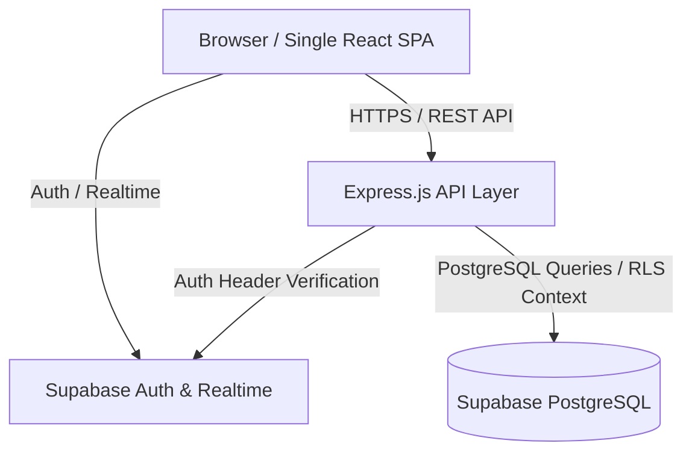

# System Architecture & Technical Specifications

## 1. High-Level Architecture
The Crimpston Accessories Management System is structured as a monorepo containing:
- `apps/web`: Single-page React application (Vite, TypeScript, Tailwind CSS, TanStack Query, React Router, React Hook Form, Zod). Houses both Owner and Employee experiences with strict role-gated UI guards.
- `apps/api`: Express.js backend (TypeScript, Zod, Helmet, Morgan, Express Rate Limit) handling verified business workflows, idempotency validation, reporting deadlines, and inventory aggregation.
- `packages/shared`: Shared TypeScript types, schema validators (Zod), and business constants shared between frontend and backend.
- `supabase`: Database migrations, RLS policies, seeds, and schema tests.

## 2. Inventory Ledger Flow
1. **Deliveries**: Recorded by Owner. Lines inserted into `deliveries` and `delivery_items`. Generates `stock_movements` (type: `DELIVERY_IN`, confirmed: true). Shop stock is immediately updated.
2. **Daily Sales Reports**: Submitted by Shop Employee. Lines inserted into `daily_reports` (status: `submitted`) and `daily_report_items`. Generates provisional stock impact.
3. **Owner Review**: Owner approves report. Status updates to `approved`. Generates `stock_movements` (type: `SALE_OUT`, confirmed: true).
4. **Physical Stock Counts**: Audited counts recorded via `stock_counts`. Variance between counted stock and confirmed stock creates audit log and pending discrepancy alert.

## 3. Data Protection & Security Controls
- **Dual-Layer Access Control**: Express API verifies user ID and shop membership; PostgreSQL RLS policies restrict all table access at the database layer.
- **Strict Data Validation**: Zod schemas validate every inbound request payload before execution.
- **Idempotency**: All mutation endpoints accept `idempotency_key` to guarantee at-most-once execution.
